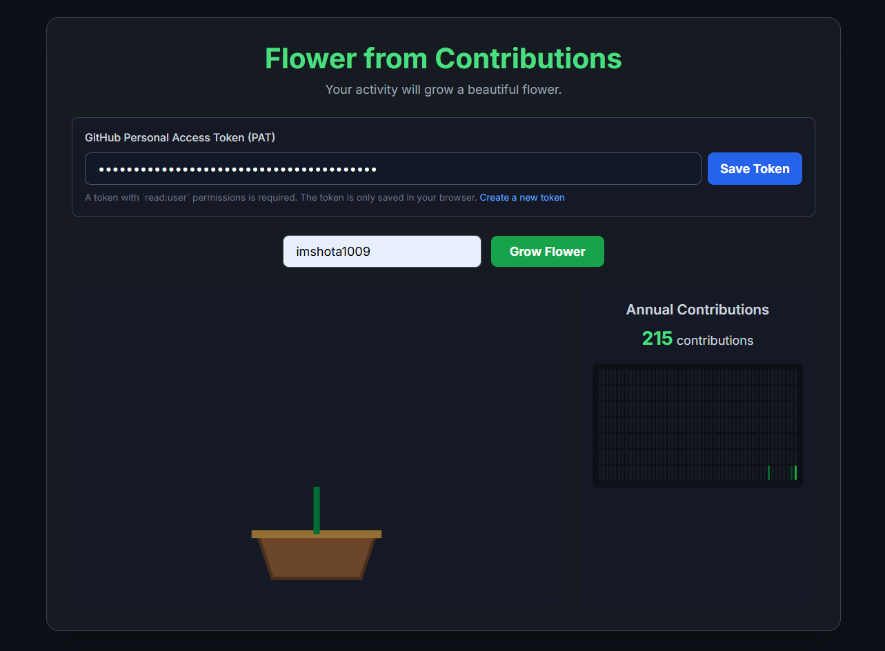

# 🌸 Contribution Flower 🌸

🇯🇵 日本語のドキュメントを表示 (Click to expand)

# 🌸 コントリビューション フラワー (Contribution Flower) 🌸

日々のGitHubコントリビューション（通称：草生やし）を力に変えて、  
美しい花を育てましょう 🌱🌼

---

## 🌼 アプリについて

あなたの **GitHub ユーザー名** と **個人用アクセストークン (PAT)** を入力するだけで、
プライベートリポジトリを含むこれまでのコントリビューションデータが、リアルタイムで成長する綺麗な一輪の花に変わります。

---

## 📸 スクリーンショット

---

## ✨ 主な特徴・機能

- **正確なデータの取得**  
  GitHubのGraphQL APIを使用して、公開リポジトリと非公開リポジトリの両方のコントリビューション（活動記録）を正しく集計します。

- **成長のビジュアル化**  
  活動量に応じて、植物が「種 → 芽 → 葉 → 満開」へと滑らかなアニメーションを伴って成長します。

- **安全な設計**  
  入力したアクセストークン（PAT）は**お使いのブラウザ内（localStorage）にのみ保存**され、外部のサーバーへ送信されることはありません。

---

## 🚀 使い方

このアプリを使用するには、**GitHubの個人用アクセストークン (PAT)** が必要です。

### 1. トークン (PAT) の作成方法

1. [トークン作成ページ](https://github.com/settings/tokens/new) にアクセスします。
2. **Note（説明）**: `Contribution Flower Viewer` など、分かりやすい名前を入力します。
3. **Expiration（有効期限）**: セキュリティのため、*90日間* をおすすめします。
4. **Scopes（権限スコープ）**: `read:user` のみにチェックを入れます。
5. ページ最下部の **Generate token（トークンを作成）** ボタンをクリックします。
6. 表示された `ghp_` から始まるトークン文字列をコピーします（一度ページを閉じると二度と表示されません！）。

---

### 2. 花を育てる

1. アプリを開きます。
2. **GitHubユーザー名** を入力します。
3. コピーした **アクセストークン (PAT)** を入力します。
4. **「Grow Flower（花を育てる）」** ボタンをクリックします。
5. あなたの今までの活動が、画面上で綺麗な花を咲かせます 🌸

---

## ⚠️ セキュリティについて

- アクセストークン（PAT）はパスワードと同じように大切に扱ってください。  
  **他人に教えたり、公開リポジトリに保存（コミット）したりしないでください。**
- 本アプリはトークンを**お使いのブラウザ（ローカルストレージ）にのみ保存**します。
- 学校やネットカフェなどの共有パソコンでは使用しないでください。

---

## 🛠️ 使用している技術

- **HTML5** – 骨組み
- **Tailwind CSS** – 画面デザイン・レイアウト
- **JavaScript (ES6+)** – 処理ロジック
- **GitHub GraphQL API v4** – 活動データの取得

🇺🇸 Show English Document (Click to expand)

# 🌸 Contribution Flower 🌸  

Turn your daily GitHub contributions ("grass")  
into the power to grow a beautiful flower 🌱🌼  

  
  
  
  

---

## 🌼 About

Simply enter your **GitHub username** and **Personal Access Token (PAT)**,  
and watch all of your contributions (including private ones) turn into a growing flower in real time.  

---

## 📸 Screenshot

---

## ✨ Features

- **Accurate Data**  
  Uses the GitHub GraphQL API to fetch both public and private contributions.  

- **Growth Visualization**  
  Your "grass" contributions transform into a flower — from seed → sprout → leaf → full bloom — with smooth animations.  

- **Secure by Design**  
  Your PAT is stored **only in your browser’s `localStorage`** and never sent to any external server.  

---

## 🚀 How to Use

This app requires a **GitHub Personal Access Token (PAT)**.  

### 1. Create a PAT

1. Go to [this page](https://github.com/settings/tokens/new)  
2. **Note**: Use a descriptive name like `Contribution Flower Viewer`  
3. **Expiration**: For security, *90 days* is recommended  
4. **Scopes**: Check only `read:user`  
5. Scroll down and click **Generate token**  
6. Copy the token starting with `ghp_` (it will only be shown once!)  

---

### 2. Grow Your Flower

1. Open the app  
2. Enter your **GitHub username**  
3. Enter your **PAT**  
4. Click **"Grow Flower"**  
5. Your contributions will bloom beautifully on screen 🌸  

---

## ⚠️ Security Notes

- Treat your PAT like a password.  
- **Do not share it or commit it to public repositories.**  
- This app stores your PAT **only in your browser’s localStorage**.  
- Avoid using the app on public or shared computers.  

---

## 🛠️ Technologies Used

- **HTML5** – Structure  
- **Tailwind CSS** – Styling  
- **JavaScript (ES6+)** – App logic  
- **GitHub GraphQL API v4** – Fetching contribution data  

